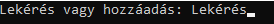
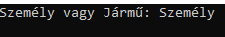
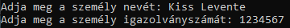
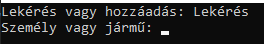
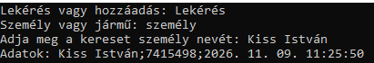
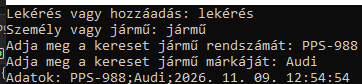

# Portás

Írja be hogy __lekérni__ vagy __hozzáadni__ szeretne-e.
A program __csak__ ezt a kettőt fogadja el. A nagy- és kisbetű nem számít.

 
 

### Hozzáadás

Hozzáadásnál írja be hogy __személy__ vagy __jármű__ érkezik.
A program __csak__ ezt a kettőt fogadja el. A nagy- és kisbetű itt sem számít.

 
 

Ha személy érkezik írja be a személy nevét és igazolvány számát.

 
 

Ha jármű érkezik írja be a jármű rendszámát és márkáját.

 
 

### Lekérés

Lekérésnél is írja be hogy __személy__ vagy __jármű__.

 
 

Írja be a személy nevét majd visszakapja a hozzá tartozó összes adatot.

 
 

Jármű lekérés esetében a rendszám és márkát kell megadni is megkapja a hozzá tartozó összes adatot.
