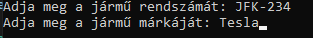

# Portás

Írja be hogy __személy__ vagy __jármű__ érkezik.
A program __csak__ ezt a kettőt fogadja el. A nagy és kisbetű nem számít.

 
 

Ha személy érkezik írja be a személy nevét és igazolvány számát.

 
 

Ha jármű érkezik írja be a jármű rendszámát és típúsát.

További teendő nincs.

