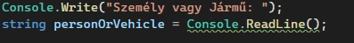
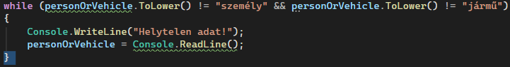
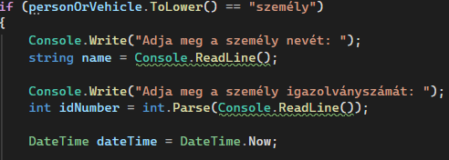
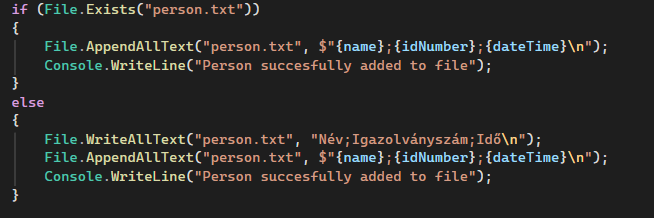
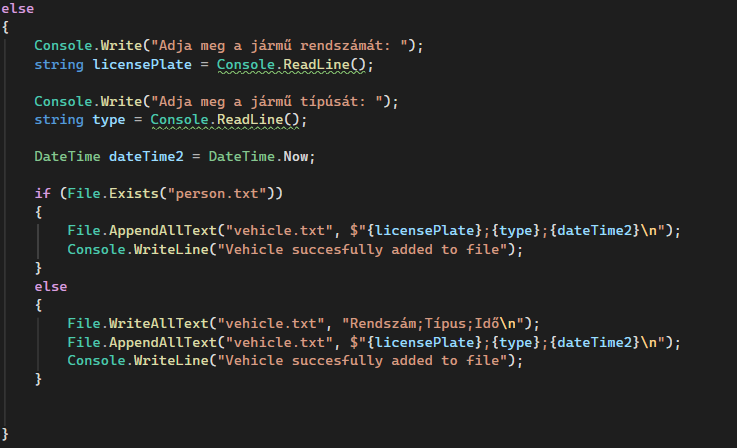

# Portás

A program be kéri és belvassa, hogy személy vagy jármű érkezik.

 
 

A program addig kéri be amíg nem személy vagy járműt ír a felhasználó.

 
 

Ha személy akkor bekéri a személy nevét, igazolványszámát és az OP rendszertől az időt.

 
 

Ha a fájl létezik hozzá adja az adatokat és ha nem akkor beírja az első sort, majd hozzá adja az adatokat.

 
 

Ez ugyanúgy megtörténik ha jármű, ahol a bekért adatok a rendszám és a típus.

